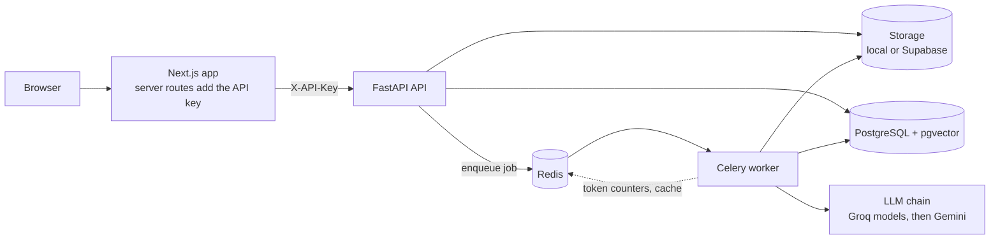
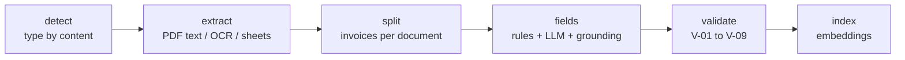

# LedQuill

LedQuill is an invoice document intelligence system. You upload an invoice file, it extracts the
text (using OCR when needed), an LLM extracts the invoice fields, the numbers are validated, and
you review, correct, approve and search the results.

- Demo web app: https://ledquill.vercel.app
- API health check: https://ledquill.onrender.com/api/v1/health (the API root path returns 404 by design)

Built as a job assessment (AI Engineer). Specs: [requirements](docs/requirements.md),
[design](docs/design.md), [product requirements](docs/prd.md). Progress: [checklist](docs/CHECKLIST.md).

## Features

- Input: PDF, JPG, PNG, TIFF (multi-frame), XLSX, XLS and CSV. File type is detected from content.
- Digital PDFs use embedded text; scans and images go through preprocessing and Tesseract OCR.
- Multi-invoice PDFs are split into separate invoices; spreadsheets are parsed across all sheets.
- Rules pre-extraction, then an LLM with a model failover chain. Values the model returns that are
  not found in the source text become null (grounding check).
- Validation rules V-01 to V-09: arithmetic, missing fields, duplicates, cross-document checks.
  Invoices with issues are flagged for review with reasons.
- Review screen with the source beside the fields, inline edits with an audit trail, approve,
  review queue, dashboard, and hybrid (keyword plus semantic) search.
- Corrupt and encrypted files fail with a readable reason; failed jobs can be reprocessed.

## Architecture



Worker pipeline, one job per uploaded document:



LLM order (`LLM_MODELS`): `groq:openai/gpt-oss-120b`, `groq:qwen/qwen3.8-27b`,
`groq:openai/gpt-oss-20b`, `gemini:gemini-3.8-flash`. Token limits are tracked per model in Redis.
The database schema is defined by the SQLAlchemy models in `backend/app/db` and the Alembic
migrations.

| Layer | Technology |
|---|---|
| API and workers | Python 3.12, FastAPI, Celery, Redis |
| Data | PostgreSQL 16 with pgvector, SQLAlchemy 2, Alembic |
| Extraction | PyMuPDF, Tesseract with OpenCV, pandas, openpyxl, xlrd |
| Embeddings | fastembed, bge-small-en-v1.5 (384 dimensions) |
| Frontend | Next.js (App Router), TypeScript, Tailwind, shadcn/ui, TanStack Query |

Repository layout:

```
backend/app/api        routers: documents, invoices, search, stats, health
backend/app/core       settings, security, logging, errors
backend/app/db         models, session, migrations (alembic)
backend/app/pipeline   detect, pdf, ocr, sheets, split, rules, validate, index
backend/app/llm        providers, rate limiter, prompts, grounding, cache
backend/app/workers    celery app and tasks
backend/app/schemas    pydantic models (API and extraction contract)
backend/tests          unit, api, fixtures
frontend/              Next.js app
evaluation/            generate.py, run_eval.py, data/, results.json, report.md
docs/                  requirements, design, prompts, AI disclosure
```

## Setup (docker compose)

Prerequisites: Docker with Compose, and Node.js for the frontend. You need a Groq API key and,
for the fallback model, a Gemini API key.

```bash
cp .env.example .env
# edit .env: set LEDQUILL_API_KEY (for example: openssl rand -hex 32), GROQ_API_KEY, GEMINI_API_KEY
docker compose up --build
docker compose exec api alembic upgrade head
```

This starts PostgreSQL (pgvector), Redis, the API on http://localhost:8000 (interactive docs at
`/docs`) and a Celery worker. Check http://localhost:8000/api/v1/health.

Frontend (separate terminal). The server-side routes need `LEDQUILL_API_URL` and `LEDQUILL_API_KEY`
in the frontend environment (for example in `frontend/.env.local`); use the same API key as the
backend and `http://localhost:8000` as the URL.

```bash
cd frontend
npm install
npm run dev        # http://localhost:3000
```

Other commands:

```bash
docker compose exec api ruff check . --fix && docker compose exec api ruff format .
cd frontend && npm run lint && npm run build
```

Processing limits are configurable in `.env` (`LEDQUILL_MAX_UPLOAD_MB`,
`LEDQUILL_MAX_FILES_PER_REQUEST`, `LEDQUILL_MAX_PDF_PAGES`, `LEDQUILL_MAX_TIFF_FRAMES`,
`LEDQUILL_MAX_IMAGE_PIXELS`). If you use Upstash instead of a local Redis, the `REDIS_URL` needs
`?ssl_cert_reqs=required`.

## Testing

```bash
docker compose exec api pytest -q
```

Last run (2026-11-24): 527 passed, 2 skipped. Live LLM tests
are opt-in (`RUN_LIVE_LLM=1`).

## Evaluation results

Source: `evaluation/results.json` and `evaluation/report.md`, produced by `evaluation/run_eval.py`
through the real API on 2026-11-22 (58 of 58 files; `clean_13.pdf` and `register_01.xlsx` were run
again afterwards and everything was rescored with the final scorer). The dataset is synthetic:
58 files, 65 invoices, generated with a fixed seed by `evaluation/generate.py`, with labels in
`evaluation/data/labels.json`.

| Metric | Result |
|---|---|
| Document status as expected | 100.0% |
| Invoice count as expected | 100.0% |
| needs_review accuracy (matched invoices) | 93.8% |
| Validation rule sets exactly right per file | 81.0% |
| Review routing (flagging follows real errors) | 94.5% |
| Files with any extraction error flagged for review | 9 of 12 |
| Fully correct files flagged although no review was expected | 0 of 43 |

Field extraction:

| Field | Precision | Recall | Hallucinated |
|---|---|---|---|
| invoice_number | 98.2% | 88.9% | 0 |
| invoice_date | 100.0% | 90.5% | 0 |
| supplier_name | 98.3% | 90.5% | 0 |
| customer_name | 98.2% | 88.9% | 0 |
| currency | 98.2% | 87.3% | 0 |
| subtotal | 100.0% | 89.1% | 0 |
| tax | 98.2% | 87.3% | 0 |
| total | 98.2% | 85.9% | 0 |
| line items (by amount) | 99.2% | 90.1% | not reported |

Timing: local run, not measured on Render. End to end (upload to terminal status) p50 2.1 s,
p95 4.1 s over 58 files. Per stage p50 / p95: fields 1377 / 2546 ms, extract 11 / 1060 ms,
index 22 / 60 ms, validate 7 / 22 ms, split 2 / 5 ms, detect 0 / 3 ms.

LLM tokens (as reported by the providers): 68,662 in total (45,132 prompt, 23,530 completion)
across the 50 files that called a model.

The full per-rule table and per-file results are in [evaluation/report.md](evaluation/report.md).

### Evaluation limitations

- All files are synthetic. No real invoices were run, so there are no real-file accuracy numbers.
- Three degraded scans are marked ready although they contain extraction errors: `scan_08_medium.jpg`,
  `scan_09_medium.png` and `scan_10_medium.tif` (9 of the 12 files with errors were flagged).
- Rule precision is low for some rules in this run: V-01 25.0% (3 true, 9 false positives),
  V-03 40.0%, V-08 50.0%, and V-02 0.0% (1 false positive); recall is 100% where the rule had
  any true cases.
- Severe scans (`scan_11` to `scan_15`) are labelled as expected to need review by policy, while
  their field labels still describe the printed invoice, so unreadable values count as misses.
- Live Gemini failover was not confirmed: the live test hit repeated provider 503 responses
  (4 attempts). Failover is covered only by tests with fake providers.

## Demo hosting

| Part | Host |
|---|---|
| Web app | Vercel |
| API and Celery worker, in one container (`prod` Docker target, `backend/start.sh`) | Render, 0.1 CPU, 512 MB |
| Postgres with pgvector, and file storage | Supabase |
| Redis | Render Key Value instance (in-memory); Upstash is the documented fallback |

Deployment notes: the browser never holds the API key; Next.js server routes add it from
`LEDQUILL_API_KEY`. The web app needs `LEDQUILL_API_URL`, `LEDQUILL_API_KEY` and
`NEXT_PUBLIC_MAX_UPLOAD_MB=4`. The API needs the variables in `.env.example`, with
`STORAGE_BACKEND=supabase`.

### Demo hosting limits

- **Slower processing (0.1 CPU).** Measured on Render: a single-page PDF or XLSX takes about
  7 to 9 s, a 1.4 MB PNG about 39 s, a 2-frame TIFF about 79 s.
- **Wake-up.** An external uptime monitor pings the health endpoint every 5 minutes to keep the
  service awake. Without it, the first request after inactivity can take about a minute (from the
  hosting provider's documentation; we did not measure the cold start).
- **Upload size.** The hosted web app accepts about 4.5 MB per request (the UI says 4 MB). Larger
  uploads are rejected by the platform with a 413 and the UI shows a "File too large" message.
  The API itself uses `LEDQUILL_MAX_UPLOAD_MB`.
- **Search.** Keyword-only on the hosted demo.
- **Shared access.** One server-side API key and one shared rate-limit bucket for all visitors.
- **Redis is in-memory.** A restart can lose queued jobs, the LLM cache and rate counters. Jobs
  left stale are reprocessed after 15 minutes (`LEDQUILL_STALE_JOB_MINUTES`).
- **LLM rate limits.** Limits are per model and token-based (Groq: 8K tokens per minute and 200K
  per day per model); the app enforces token limits only.
- **Gemini failover** has not been confirmed live (see Evaluation limitations).
- **Memory** was measured locally under the same limits (512 MB, 0.1 CPU): worst anonymous-memory
  peak 375 MiB, on a 2-frame TIFF, with no out-of-memory kill. The hosting plan shows no memory
  metrics, so it was not read on Render.

## Known limitations

- Retrying a job deletes the stored pages and re-runs OCR; stored pages are not reused.
- Duplicate flags (V-07, V-09) are set only on the later-processed invoice. A same-hash duplicate
  upload for which no invoice row exists is not caught.
- Line items are read-only in the review screen.
- Hybrid search only (no mode toggle in the UI).
- The frontend performance budget in `docs/prd.md` section 8, Lighthouse, and a 1000-page PDF
  were not measured.
- Supabase bucket cleanup after tests and the Redis `llm:cache` keys written on Render were not
  checked.
- Status rule: a single V-02 or V-03 warning keeps an invoice "ready", and tax is not a required
  field. This is why `scan_08_medium.jpg`, `scan_09_medium.png` and `scan_10_medium.tif` are
  silently ready.
- Severe scans usually yield no extractable fields (they are flagged for review with a poor-scan
  warning; recall is near zero). Mild and medium scans can have OCR misreads; some are caught by
  V-01, V-02 or V-03.
- V-09 uses a one-cent tolerance; arithmetic checks use 0.5%.
- Only comma-grouped Indian numbers (for example 1,23,456.00) are recognised.
- Uploading the same file twice creates two documents; the later invoice is flagged V-07/V-09, as
  designed.
- Model confidence values are not calibrated. Subtle prompt injection can still ground a wrong
  value.
- LLM answers are cached by text hash, so repeat runs report fewer tokens. Token totals count only
  the winning model's call after a failover.
- The "No invoice found" message is stored but not shown in the UI. The UI maps every 500 error to
  a generic message.
- The invoice splitter can be misled by a letterhead edge case and by a loose decimal regex on odd
  sheets.

## LLM prompts

The extraction prompt, output schema and retry suffix are in
[backend/app/llm/prompts.py](backend/app/llm/prompts.py) (version `extract-v1`); see also
[docs/prompts.md](docs/prompts.md). Document text is treated as untrusted data, wrapped in a
delimited block, and the model has no tools.

## AI-use disclosure

Claude Code wrote the code under the rules in [CLAUDE.md](CLAUDE.md). A Claude chat was used for
design, prompts and report review. The developer tested by hand and ran every git command. The
product itself calls Groq and Gemini models. Details: [docs/ai-disclosure.md](docs/ai-disclosure.md).
