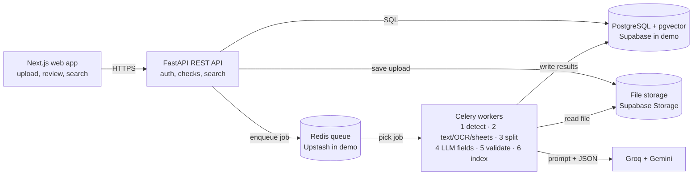
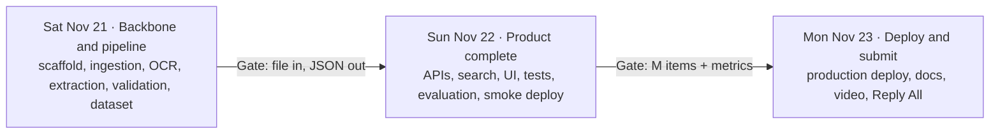

# LedQuill — Requirements Analysis & Project Plan

Nov 21, 2026 · @Rakesh Biswas

We will build LedQuill, an invoice-focused document intelligence system, in two build days (Nov 21-22, 2026) and deploy plus submit on Nov 23. This document is SDLC phases 1 and 2: what we must build (Part A) and how we will build it (Part B). Design, test plan and deployment docs follow as separate documents.

| Item | Value |
| --- | --- |
| Project | AI-Powered Document Intelligence System (Care Guide AI Engineer assessment) |
| Version | 1.0 (draft) |
| Build window | Nov 21-22, 2026 |
| Deploy and submit | Nov 23, 2026 (official deadline Nov 26) |
| Submission | Reply All to the original email, keep apply@careguidebd.com |

Guiding rule: a working, honest, well-documented MVP beats a half-finished "complete" system. Every scope decision below follows that rule.

# Part A: Requirements Analysis

## 1. Problem and goals

Staff manually read invoices, receipts, scans, images and spreadsheets, retype the data, check the math and cross-check documents against each other. This is slow and error-prone. Some PDFs run to about 1,000 pages.

Goals of the system:

1. Ingest mixed files and turn them into text or tables automatically.
2. Extract invoice fields into structured JSON, never inventing values.
3. Validate the numbers and flag records that need a human.
4. Make everything searchable and correctable through an API and a web UI.
5. Prove quality with measured metrics, not claims.

## 2. Scope

**In scope (MVP)**

- Upload of PDF, JPG, PNG, TIFF, XLSX, XLS, CSV (many files at once)
- Digital PDF text extraction, OCR for scans and images, spreadsheet parsing (all sheets)
- Splitting large multi-invoice PDFs into individual invoices
- LLM-based field extraction with confidence and null for unknown values
- Validation rules, duplicate detection, manual-review flag
- Cross-verification: PDF vs PDF and PDF vs Excel, matched by invoice number
- REST API, background jobs, PostgreSQL storage, keyword and semantic search
- Next.js UI for upload, progress, review, correction, search
- Automated tests, labeled evaluation set, measured report, walkthrough video

**Out of scope (stated in README as future work)**

- User accounts with roles (MVP uses a single API key)
- Pushing data into an ERP or accounting system
- Non-invoice document types (contracts, statements)
- Handwriting recognition, languages other than English
- Kubernetes or multi-region deployment

## 3. Users

| User | Needs |
| --- | --- |
| Accounts / data-entry staff | Upload files, see extracted data, fix mistakes |
| Finance reviewer | See flagged records and why they were flagged |
| Developer / integrator | Call the API from other systems |
| Assessment reviewer (Care Guide) | Run it easily, read the docs, see real metrics |

## 4. Functional requirements

Priority uses MoSCoW: **M** = must have for submission, **S** = should have, **C** = could have if time allows.

| ID | Requirement | Task | Priority |
| --- | --- | --- | --- |
| FR-01 | Upload one or many files (PDF, JPG, PNG, TIFF, XLSX, XLS, CSV) in one request | 1, 4 | M |
| FR-02 | Detect real file type by content (magic bytes), reject unsupported or oversized files | 1 | M |
| FR-03 | Extract text from digital PDFs page by page | 1 | M |
| FR-04 | OCR scanned PDF pages and images, with preprocessing for poor quality (grayscale, deskew, denoise, threshold) | 1 | M |
| FR-05 | Parse every sheet of XLSX/XLS and CSV into rows, handle messy headers | 1 | M |
| FR-06 | Handle corrupted or password-protected files: mark job failed with a clear reason, never crash the worker | 1 | M |
| FR-07 | Split a multi-page PDF into separate invoices (page-boundary detection) | 1, 2 | M |
| FR-08 | Extract invoice\_number, invoice\_date, supplier\_name, customer\_name, subtotal, tax, total, currency, line\_items | 2 | M |
| FR-09 | Return null plus low confidence for missing or unclear fields; never invent values | 2 | M |
| FR-10 | Validate required fields, numeric format, date format, currency code | 3 | M |
| FR-11 | Check math: sum(line items) = subtotal, subtotal + tax = total (with rounding tolerance) | 3 | M |
| FR-12 | Detect duplicates (same supplier + invoice number, or same file hash) | 3 | M |
| FR-13 | Set needs\_review = true with a list of reasons when any rule fails or confidence is low | 3 | M |
| FR-14 | Cross-verify the same invoice across PDF-PDF and PDF-Excel sources and report field mismatches | 3 | S |
| FR-15 | API: upload, job status, results, search, manual correction, reprocess failed job | 4 | M |
| FR-16 | Run OCR and LLM work in background workers, never in the request | 4 | M |
| FR-17 | Store metadata, raw text, structured results, validation errors, processing history | 5 | M |
| FR-18 | Keyword filtering (supplier, date range, amount range, status, invoice number) | 5 | M |
| FR-19 | Semantic search over document text using embeddings | 5 | M |
| FR-20 | UI: multi-upload with progress, document list, detail view, error view, inline correction, search | 6 | M |
| FR-21 | Keep an audit trail of manual corrections (old value, new value, time) | 4, 5 | S |
| FR-22 | Export results as JSON or CSV | 4 | C |

## 5. Non-functional requirements

Targets are goals for the MVP; the evaluation report will state what we actually measured.

| ID | Quality | Target |
| --- | --- | --- |
| NFR-01 | Performance | Upload API responds in under 1 s; processing is async. Digital PDF page in under 1 s, OCR page in a few seconds |
| NFR-02 | Scalability | Workers scale horizontally (add containers); a 1,000-page PDF is processed in page batches, not loaded whole into memory |
| NFR-03 | Reliability | Jobs retry automatically (3 attempts, backoff); failed jobs keep their error and can be reprocessed; uploads are idempotent by file hash |
| NFR-04 | Security | API key auth, file type and size checks, no secrets in git (.env), parameterized SQL via ORM, CORS limited to the frontend, files stored outside web root |
| NFR-05 | Accuracy honesty | No invented values; every field carries a confidence score; low confidence goes to review |
| NFR-06 | Observability | Structured logs per job and stage, timing stored per stage in processing history |
| NFR-07 | Maintainability | Clear module boundaries, typed code (Pydantic, TypeScript), linting, tests in CI |
| NFR-08 | Portability | Whole stack starts with one command: `docker compose up` |

## 6. Extraction output contract

Every extracted invoice follows one JSON shape. Each scalar field holds a value (or null) and a confidence from 0 to 1.

```json
{
  "invoice_number": {"value": "INV-1042", "confidence": 0.98},
  "invoice_date":   {"value": "2026-10-03", "confidence": 0.95},
  "supplier_name":  {"value": "Acme Supplies Ltd", "confidence": 0.97},
  "customer_name":  {"value": null, "confidence": 0.0},
  "currency":       {"value": "BDT", "confidence": 0.90},
  "subtotal":       {"value": 1000.00, "confidence": 0.96},
  "tax":            {"value": 150.00, "confidence": 0.96},
  "total":          {"value": 1150.00, "confidence": 0.97},
  "line_items": [
    {"description": "A4 paper", "quantity": 10, "unit_price": 100.00, "amount": 1000.00}
  ],
  "source": {"document_id": "uuid", "pages": [3, 4]}
}
```

Rules: dates in ISO 8601, amounts as decimals, currency as ISO 4217 code. A value not visibly present in the document must be null.

## 7. Validation rules

| Rule | Check | Severity |
| --- | --- | --- |
| V-01 Required | invoice\_number, invoice\_date, supplier\_name, total are present | Error |
| V-02 Numeric | subtotal, tax, total, line amounts are valid non-negative numbers | Error |
| V-03 Line math | quantity x unit\_price = amount for each line (tolerance 0.01) | Warning |
| V-04 Subtotal | sum of line amounts = subtotal (tolerance 0.01 or 0.5%) | Error |
| V-05 Total | subtotal + tax = total (same tolerance) | Error |
| V-06 Date | parses, not in the future, not before 2000 | Warning |
| V-07 Duplicate | same supplier + invoice number, or same file hash, already stored | Error |
| V-08 Confidence | any required field below 0.7 confidence | Warning |
| V-09 Cross-check | the same invoice in another source differs on total, date or supplier | Error |

Any Error, or two or more Warnings, sets `needs_review = true`. Each failure is stored with rule ID, field, expected value and actual value so the UI can explain it.

## 8. Assumptions and open questions

No sample data came with the task, so we decide these ourselves and state them in the README.

- **A1.** Documents are mainly English invoices; currency may be BDT, USD, EUR or others.
- **A2.** One large PDF can hold many invoices; one invoice can span several pages.
- **A3.** In spreadsheets, one row = one invoice (or one line item grouped by invoice number). Column names vary, so the LLM maps headers to our fields.
- **A4.** "Cross-verification" means: the same invoice number appears in two sources (two PDFs, or a PDF and an Excel register) and key fields must match.
- **A5.** We build our own labeled dataset: synthetic invoices generated from known ground truth, rendered to PDF, then degraded (rotation, blur, noise) to simulate scans, plus a few real public sample invoices.
- **Q1.** Is a hosted LLM API acceptable for confidential financial data? Resolved: the demo processes synthetic invoices only; the LLM provider is swappable by config, including a self-hosted model for production data.

## 9. Risks

| Risk | Impact | Mitigation |
| --- | --- | --- |
| Two days is very tight | Unfinished features | Strict MoSCoW; vertical slice first (upload to result end to end), polish last |
| OCR quality on bad scans | Wrong fields | Image preprocessing, confidence scores, review flag; report the real accuracy |
| LLM hallucination | Invented values | Strict JSON schema, "null if not present" prompt, verify extracted numbers appear in source text |
| LLM provider rate limits (200K tokens/day per model) | Large batches stall | Rules first, LLM only for invoice pages; rotate 3 Groq models then Gemini; cache by file hash; wait and retry on 429 (section 12.2) |
| Deployment issues on Nov 23 | Late demo | Docker from hour one; deploy a smoke version on the evening of Nov 22 |
| Demo hosting limits: 512 MB RAM, idle sleep after 15 min, no persistent disk | Crashes | API and worker in one container, concurrency 1, files in Supabase Storage; Cloudflare Tunnel from the laptop as fallback |

## 10. Acceptance criteria

The submission is accepted by us when all of these are true:

- [ ] Every M requirement works in the deployed app
- [ ] One sample of each file type processes end to end in the walkthrough video
- [ ] A corrupted file fails gracefully and can be reprocessed
- [ ] Tests pass in CI; the results are committed
- [ ] The evaluation report shows measured field accuracy, processing time, success rate and failure rate
- [ ] README lets a stranger run it with `docker compose up` in under 10 minutes
- [ ] Architecture diagram, DB schema, prompts and AI-use disclosure are in the repo

# Part B: Project Plan

## 11. Architecture overview

We use a simple queue-based design: the API stores the upload and returns at once; background workers do the slow OCR and AI work and write results to PostgreSQL. The UI polls job status.



To handle more load we add worker containers; nothing else changes. A 1,000-page PDF becomes many small page-batch jobs, so one big file never blocks the queue.

## 12. Tech stack and why

The task suggests NestJS, but every heavy step (PDF, OCR, pandas, LLM SDKs) lives in Python. One Python codebase for API and workers removes a whole service boundary, which matters most in a two-day build.

| Layer | Choice | Why (alternative considered) |
| --- | --- | --- |
| Backend API | Python 3.12 + FastAPI | Async, typed with Pydantic, automatic OpenAPI/Swagger docs. (NestJS would need a separate Python OCR service.) |
| Background jobs | Celery + Redis | Retries, backoff, concurrency and scheduling built in; Redis also holds live progress. (BullMQ is Node-only.) |
| Database | PostgreSQL 16 | Invoices, line items and history are relational; JSONB keeps raw LLM output; built-in full-text search and pg\_trgm for keyword search. (MongoDB is weaker for joins and math checks.) |
| Vector search | pgvector inside PostgreSQL | One database instead of two; filters and vector search in one SQL query. (Qdrant or Pinecone add another service.) |
| ORM and migrations | SQLAlchemy 2 + Alembic | Standard, safe parameterized queries, versioned schema |
| PDF text | PyMuPDF | Very fast, reads page by page (good for 1,000 pages), renders pages to images for OCR |
| OCR | Tesseract 5 (pytesseract) + OpenCV preprocessing | Open source, runs locally, data stays in-house. (PaddleOCR is stronger on bad scans but heavier; kept behind an interface to swap later.) |
| Spreadsheets | pandas + openpyxl (XLSX) + xlrd (XLS) | Standard, reads every sheet, handles CSV encodings |
| LLM extraction | Groq: openai/gpt-oss-120b (primary), qwen/qwen3.8-27b and openai/gpt-oss-20b (fallbacks), then Google gemini-3.8-flash. JSON output, temperature 0, behind a provider interface | Very low latency; each model has its own rate limit, so failover multiplies capacity; open-weight primary models avoid lock-in; swappable by config |
| Embeddings | fastembed with bge-small-en (384 dims), local | Runs locally, so document text never leaves the system; light (ONNX, no PyTorch); good enough for invoice search |
| Frontend | Next.js + TypeScript + Tailwind + shadcn/ui, TanStack Query | Fast to build clean UI; Query handles polling and caching of job status |
| Testing | pytest, httpx test client, Vitest (light) | Covers units, API and failure cases; CI runs them |
| Code quality | Ruff, ESLint, pre-commit, GitHub Actions | Consistent code, tests on every push |
| Deployment | Local: Docker Compose (full stack). Live demo: Vercel (web), Render (API + worker in one container), Supabase (DB + files), Upstash (Redis) | Managed HTTPS and quick setup; the same Docker image runs locally and on Render |

### 12.1 External services

| Service | Role | Environment |
| --- | --- | --- |
| GitHub | Source code, CI (GitHub Actions) | All |
| Groq | Primary LLM provider | All |
| Google AI Studio | Fallback LLM provider (Gemini) | All |
| Supabase | PostgreSQL + pgvector, file storage (bucket `documents`) | Demo |
| Upstash | Redis (job queue, cache) | Demo |
| Render | Backend hosting (API + worker) | Demo |
| Vercel | Frontend hosting | Demo |

Locally the whole stack (Postgres, Redis, API, worker, web) runs in Docker Compose; only the LLM providers are external.

### 12.2 LLM capacity planning

Provider rate limits per model for the account used, read from the Groq limits page on Nov 21, 2026:

| Model | RPM | RPD | TPM | TPD |
| --- | --- | --- | --- | --- |
| openai/gpt-oss-120b (primary) | 30 | 1K | 8K | 200K |
| qwen/qwen3.8-27b (fallback 1) | 30 | 1K | 8K | 200K |
| openai/gpt-oss-20b (fallback 2) | 30 | 1K | 8K | 200K |
| gemini-3.8-flash (fallback 3; gemini-2.5-flash is closed to new users) | to be measured |  |  |  |

One invoice extraction uses roughly 2-3K tokens (prompt, OCR text, JSON output). Tokens, not requests, are the tight limit: about 3 invoices per minute and 70-100 per day per model, so about 200-300 per day with three models rotated. These are estimates; the evaluation report will state measured numbers.

Design consequences:

1. Rules first: page classification and regex pre-extraction need no LLM; the LLM fills gaps and confirms.
2. Every request stays under 8K tokens: only invoice pages, trimmed text. gpt-oss runs with reasoning\_effort low and include\_reasoning false (measured on a test call: 205 to 156 tokens, reasoning 54 to 16).
3. A token-bucket limiter per model; on a 429 the job waits or moves to the next model.
4. Results are cached by file hash, so reprocessing makes no new LLM calls.
5. The evaluation set (about 60 invoices) fits within one day of rate limits.
6. Throughput scales with the provider plan or by adding providers; no code change is needed.

### 12.3 Architecture decision records

| ADR | Decision | Why | Trade-off |
| --- | --- | --- | --- |
| ADR-001 | Python (FastAPI + Celery) instead of the suggested NestJS | OCR, PDF, pandas, embeddings and LLM SDKs are Python; one language gives one schema (Pydantic), one test suite, one image | Not the suggested stack; mitigated because workers are queue-driven, so the API layer can be rewritten in NestJS later |
| ADR-002 | Every external provider (LLM, database, queue, storage, hosting) behind an interface and env config | Portability: the same code runs locally and in the demo, and providers can be swapped without code changes | The demo host sleeps after 15 min idle (about 1 min wake-up) and runs the worker inside the API container |
| ADR-003 | PostgreSQL for data, full-text search and vectors (pgvector) | One database instead of a separate vector DB; filters and similarity in one query | Very large vector sets would later need a dedicated vector store |
| ADR-004 | Synthetic labeled dataset generated from known ground truth | No sample data was provided; ground truth is exact | Must add real public invoices too, so accuracy is not overstated |

## 13. Timeline

We build a thin end-to-end slice first, then widen it. Each day ends with a gate; if a gate is missed, we cut from the list in section 14 instead of moving the date.



Run in parallel today: email both referees now (they need time to agree), and update the CV and portfolio in short breaks.

## 14. Scope cuts if we fall behind

Cut in this order, and say so honestly in the README:

1. FR-22 export (C)
2. FR-21 correction audit trail: keep the latest value only
3. FR-14 cross-verification: PDF vs Excel only, skip PDF vs PDF
4. Frontend polish: plain tables instead of rich views

Never cut: OCR, extraction, validation, background jobs, search, tests, the measured evaluation.

## 15. Repository structure

```
ledquill/
  backend/
    app/
      api/          # FastAPI routers: documents, jobs, search, corrections
      core/         # config, security, logging
      db/           # SQLAlchemy models, Alembic migrations
      pipeline/     # detect, pdf, ocr, sheets, split, extract, validate, embed
      workers/      # Celery app and tasks
      schemas/      # Pydantic models (extraction contract)
    tests/
  frontend/         # Next.js app
  evaluation/       # dataset generator, labeled set, eval script, report
  docs/             # requirements, design, architecture, schema, prompts, AI disclosure
  docker-compose.yml
  .env.example
  README.md
```

## 16. Definition of done

A feature is done when it works through the API and the UI, has at least one test (including a failure case), logs errors clearly, and is noted in the README.

## 17. Deliverables checklist

- [ ] Git repository with source code
- [ ] README and setup instructions
- [ ] Architecture diagram and database schema
- [ ] Working backend API and frontend (deployed link)
- [ ] PDF, image, Excel and CSV pipelines
- [ ] Automated tests and test results
- [ ] Evaluation report with measured metrics
- [ ] Recorded walkthrough video
- [ ] AI prompts and AI-assistance disclosure
- [ ] Updated CV, portfolio, two official references
- [ ] Reply All to the original email, apply@careguidebd.com included

## 18. Next SDLC documents

After this, in order: System Design (DB schema, API spec, prompt design), Test Plan, Deployment Guide, Evaluation Report.
