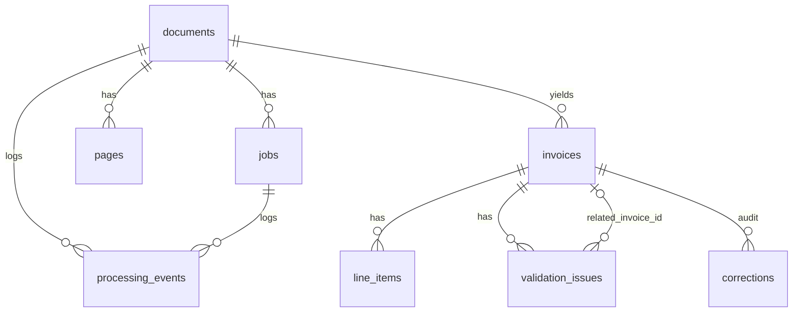

# Database schema

Source of truth: the SQLAlchemy models in [backend/app/db/models.py](../backend/app/db/models.py) and
the Alembic revisions in `backend/app/db/migrations`. Design intent and the original column
rationale are in [design.md](design.md) section 2. PostgreSQL 16 with the `pgvector` and `pg_trgm`
extensions. Money is `numeric`, never float. Primary keys are UUIDs, except `processing_events`
(bigint).

All child foreign keys cascade on delete, except `validation_issues.related_invoice_id`, which is
a plain reference to another invoice (duplicate and cross-check findings).

| Table | Purpose | Key columns |
|---|---|---|
| `documents` | Uploaded file metadata and processing status | `filename`, `file_type` (pdf, image, xlsx, xls, csv), `sha256`, `size_bytes`, `storage_key`, `page_count`, `status`, `progress`, `error`, `archived_at` |
| `jobs` | One processing attempt per document | `document_id`, `kind` (process, reprocess), `status`, `attempts`, `current_stage`, `error`, `started_at`, `finished_at` |
| `pages` | Extracted text per page or sheet | `document_id`, `page_no` (unique per document), `method` (text, ocr, sheet), `text`, `ocr_confidence` |
| `invoices` | Structured extraction result and search data | `document_id`, `page_numbers`, `invoice_number`, `invoice_date`, `supplier_name`, `customer_name`, `currency`, `subtotal`, `tax`, `total` (`numeric(14,2)`), `confidence` (jsonb), `raw_extraction` (jsonb), `method`, `model`, `status`, `supplier_norm`, `search_text`, `search_tsv`, `embedding` (`vector(384)`), `archived_at` |
| `line_items` | Invoice lines | `invoice_id`, `line_no`, `description`, `quantity`, `unit_price`, `amount` |
| `validation_issues` | Rule findings V-01 to V-09 | `invoice_id`, `rule_id`, `severity` (error, warning), `field`, `expected`, `actual`, `message`, `related_invoice_id` |
| `corrections` | Audit trail of manual edits | `invoice_id`, `field`, `old_value`, `new_value`, `note` |
| `processing_events` | Per-stage processing history | `document_id`, `job_id`, `stage`, `status` (started, succeeded, failed), `duration_ms`, `detail` (jsonb) |

Indexes worth knowing:

- Keyword search: generated `search_tsv` (`tsvector`, GIN) on `invoices`, plus trigram GIN indexes
  on `supplier_name` and `invoice_number` (and on `documents.filename`).
- Semantic search: HNSW index on `invoices.embedding` with cosine distance (384 dimensions,
  fastembed `bge-small-en-v1.5`).
- Duplicate checks: `(supplier_norm, invoice_number)` on `invoices`, `sha256` on `documents`.
- Lists and dashboards: `documents(status, created_at desc)`, `invoices(status)`,
  `invoices(invoice_date)`, `invoices(total)`, and `archived_at` on both tables.
